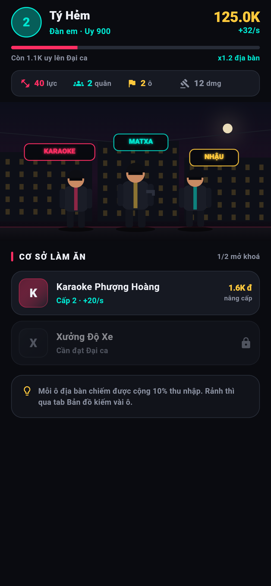
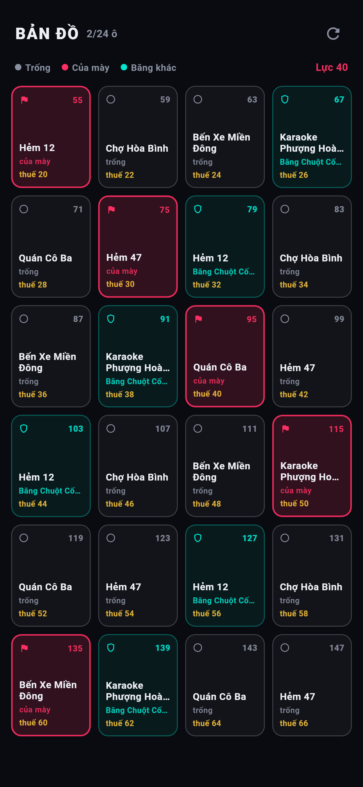
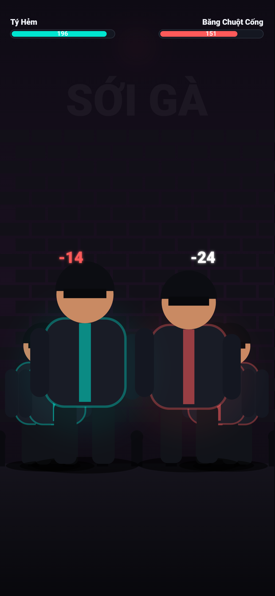

# Giang Hồ Bụi Đời — prototype

Idle mafia Việt Nam: nuôi quân, chiếm địa bàn, thu bảo kê từ karaoke/matxa/quán nhậu.
Client Flutter + Flame (2D), server Go (authoritative), chạy được ngay không cần DB.





## Cấu trúc

```
server/                 Go server, stdlib + in-memory state (port 8089)
  game.go               định nghĩa cấp bậc, vũ khí, cơ sở, địa bàn, công thức
  store.go              kinh tế, nâng cấp, mộ quân, mô phỏng trận, xếp hạng
  api.go                HTTP JSON API + CORS
  game_test.go          test kinh tế / trận / cooldown / cấp bậc
client/                 Flutter app
  lib/models.dart       model + format tiền kiểu Việt
  lib/api.dart          HTTP client (tự chọn base URL theo nền tảng)
  lib/controller.dart   state + polling 2s
  lib/scene/            Flame: sân băng (home) và sân chém (trận)
  lib/screens/          Bang / Bản đồ / Quân / Chợ đen / Băng
```

## Chạy

Server:

```bash
cd server
go run .
# hoặc: ADDR=:8089 go run .
```

Client (web):

```bash
cd client
flutter run -d chrome
```

Android emulator dùng `10.0.2.2:8089` tự động. Máy thật / server khác:

```bash
flutter run --dart-define=API_URL=http://192.168.1.10:8089
```

Test:

```bash
cd server && go test ./...
cd client && flutter analyze && flutter test
```

## Gameplay đã có trong bản thử

- 3 trục: tiền (cơ sở), lực (vũ khí + quân), uy (thắng trận) + 6 cấp bậc
  Con đỏ → Đàn em → Đại ca → Băng trưởng → Trùm quận → Ông trùm.
- Thu nhập theo giây, cộng dồn offline, chặn trần 8 giờ.
- 6 cơ sở, mở khoá theo cấp bậc; nâng cấp tăng thu nhập.
- **33 tỉnh/thành** (bản đồ 2025), mỗi tỉnh chia **12 quận** = 396 ô. Mỗi ô có chủ
  (trống / băng NPC / người chơi), thuế và phòng thủ.
- **6 vùng kinh tế**: Miền Bắc, Bắc Trung Bộ, Duyên hải Trung Bộ, Tây Nguyên,
  Đông Nam Bộ, ĐBSCL. Giữ ≥1 quận ở vùng mới làm ăn được ở vùng đó; Hồ Chí Minh
  là nhà nên luôn mở.
- Trận chém 3–5 vs 3: server mô phỏng và trả event, client chỉ replay
  (không tính toán ở client nên không sửa được kết quả).
- Sát thương popup, thanh máu, rung màn hình, lunge khi ra đòn.
- Nâng vũ khí: Mã tấu → Phớ → Súng lục → Hàng nóng.
- Mộ đàn em: mỗi đàn em +6 lực, +20 máu, kèm 1 kỹ năng tiềm ẩn
  (Thường/Hiếm/Đặc biệt: Dao Bén, Máu Liều, Trâu Bò, Né Đòn, Chém Lén,
  Mồm To, Sát Thủ, Đệ Tử Ruột, Trùm Khu). Kỹ năng có hiệu lực thật trong trận.
- Level 1–50 + EXP từ thắng trận/nâng cơ sở/mộ quân/nhiệm vụ. Mỗi level +1 điểm
  chia vào Máu (+25), Sát thương (+3), Lì đòn (−2% dmg nhận, cap 50%).
- Nhiệm vụ: 6 nhiệm vụ một lần + 3 nhiệm vụ ngày reset 00:00 (giờ VN),
  target và thưởng scale theo level.
- Băng đảng: lập băng 2.000đ, tối đa 10 người, mỗi thành viên +2% lực (cap 20%).
- Ngoại giao băng: bảng xếp hạng băng đảng chia **Tier 1/2/3** theo tổng lực.
  - **Liên minh**: tối đa 2 đồng minh/băng (7 ngày), đồng minh không chém nhau.
  - **Cống nộp**: băng mạnh hơn ≥20% có thể bắt băng yếu nộp 10% thu nhập vào quỹ
    băng mình; băng nộp cống không bị băng thu cống đánh, nhưng có thể cắt cống
    (bên kia nhận tin và đánh tự do).
  - **Tuyên chiến**: 30 phút, loot +25%, uy thưởng thêm; đồng minh của cả hai bên
    bị kéo vào chiến, kết minh với bên kia sẽ bị cắt.
  - **Thưởng chiến băng 22:00**: top 1 +5.000 quỹ +1.000đ/+50 uy mỗi thành viên;
    top 2 +3.000 quỹ +600đ/+30 uy; top 3 +1.500 quỹ +300đ/+15 uy.
  - **Tiêu quỹ băng** (băng trưởng): nâng lực băng +1% vĩnh viễn (3.000 + 1.000/cấp),
    khiên cả băng 30 phút (2.500), chiến phí +10% lực 30 phút (2.000).
  - **Log bị đánh**: hộp thư có nút XEM LẠI (replay từ góc nhìn nạn nhân) và
    PHẢN CÔNG 1 chạm vào đúng ô vừa mất.
  - Quan hệ hiện trên từng ô băng: BĂNG MÀY / ĐỒNG MINH / ĐANG CHIẾN / NỘP CỐNG / THU CỐNG.
  - **Sơ đồ ngoại giao**: tab Băng → nút SƠ ĐỒ. Vẽ toàn bộ mạng quan hệ (xanh =
    liên minh, đỏ = chiến, vàng + mũi tên = cống nộp) kèm danh sách cạnh và thời hạn.
- **Lính đông**: mộ hàng loạt tới 500 lính (rẻ hơn đàn em tinh nhuệ), 2 lính
  khỏe +1 lực. Shop bán Dao phay (+1 lực/lính) và Kiếm Nhật (+2 lực/lính), mỗi
  lính cầm 1 món. Chém nhau lính bị thương (thắng −10%, thua −16% quân khỏe);
  thương binh không ra trận, tự hồi 1/phút hoặc mua băng bó 15đ/thương.
  Băng càng đánh nhiều càng mất lực → tự chống snowball.
- Chống snowball: giới hạn số ô theo bậc (4 + 4×bậc), mất đất được khiên 30 phút,
  người uy thấp không bị đại ca bắt nạt, hệ số thu nhập địa bàn cap 1.5×.
- **Thành**: giữ trọn 12 quận của một tỉnh thì tỉnh thành "thành" của mình,
  mỗi tỉnh có 3 slot công trình (mở khi giữ ≥1 quận ở tỉnh đó). Mất sạch đất của
  tỉnh là công trình ngủ đông tới khi chiếm lại.
- **Công trình** theo tỉnh (mỗi loại 3 cấp, giá 1.500–2.500 × (cấp+1)²):
  Chợ đen (+6 hàng/giây), Trại lính (+25 lính tối đa, +5 phòng thủ mỗi ô),
  Sòng bài (+8% thu nhập toàn bộ).
- **Hàng hóa**: nguồn thứ hai (0,5/quận + chợ). Lính ăn 0,1 hàng/giây; hết hàng
  thì lính bỏ đi. Đàn em/tướng vẫn ăn lương tiền. Muốn nuôi quân đông phải giữ
  đất có chợ.
- **Cơ sở làm ăn theo vùng**: 6 cơ sở × 6 vùng, mỗi vùng lên cấp riêng; nâng cấp
  cần giữ ít nhất 1 quận ở vùng đó. UI tab Bang có hàng chip chọn vùng.
- Chống snowball băng: tuyên chiến chỉ khi băng mục tiêu còn ≥50% lực băng mình,
  mỗi băng chỉ 1 cuộc chiến và nghỉ 30 phút sau khi dứt; cống nộp tối đa 2 băng
  chủ; khiên băng có cooldown 4 giờ/lần; tier yếu hơn được +20% phòng thủ và
  bên mạnh hơn bị giảm 15–30% loot/uy khi chém tier thấp.
- Hộp thư: bị chém thì nhận tin kèm cửa sổ phản công 30 phút (+25% loot khi đánh trả).
- Hợp đồng: 3 kèo mỗi ngày scale theo level, đặt cọc, 15–20 phút, trễ hạn mất cọc.
- Sòng bạc tài xỉu: 5 lượt/ngày, trả 1.9 lần, bão 3/18 nhà ăn hết.
- Chiến băng 20:00–22:00 mỗi ngày: chiếm ô của băng khác được +2 điểm chiến.
- Boss tuần: 120.000 máu dùng chung, 3 lượt/ngày, có bảng top damage.
- Bộ sưu tập: Xe Wave (+8% thu nhập), Dây chuyền (+5% uy), Đồng hồ (+10% loot).
- Đội hình: Cân bằng / Tiên phong (+15% dmg, −10% máu) / Đánh lén (−10% dmg,
  đòn hiểm nhanh hơn). Đổi trong tab Quân.
- Chia quân giữ đất: mỗi đàn em +10 phòng thủ, mỗi 2 lính +1 phòng thủ; quân đang
  giữ không đi chém, nên lực tấn công giảm đúng theo số đang giữ.
- Độ nóng: chém thắng +8, thua +3, tự nguội 1 điểm/3 phút. Nóng làm giảm thu nhập
  tới 50%, từ 80 trở lên không chém được; đút lót 80đ/điểm để về 0.
- Truy nã: treo tối thiểu 500đ lên đầu người khác; ai hạ được trong trận nhận hết.
  Bảng uy tín hiện số tiền truy nã, bấm vào tay chơi để treo thêm.
- Nâng cấp địa bàn (tối đa cấp 5): +20% thuế và +8 phòng thủ mỗi cấp, giá
  600×(cấp+1)². Địa bàn còn sinh thu nhập thụ động theo thuế × cấp.
- Cốt truyện 6 chương theo quận: mở bằng số ô + uy, đánh trùm server-side,
  thưởng tiền/uy/EXP và mở chương tiếp.
- Prestige "ra tù": cần 15.000 uy, reset tiền/cơ sở/địa bàn/quân/cấp, giữ đồ sưu
  tập, nhận Máu giang hồ +10% thu nhập và lực mỗi lần (vĩnh viễn).
- Mùa giải theo tháng: uy kiếm trong mùa tách riêng (SeasonUy), reset đầu tháng.
- Bảng uy tín, cooldown 2s giữa các trận, chống đánh địa bàn của mình.

## Dữ liệu demo

Bấm **VÀO BẢN DEMO** ở màn đăng nhập (hoặc `POST /api/dev/login`) để seed sẵn:

- 5 tay chơi, 4 băng: Băng Rắn Độc (T1, mày), Băng Ó Đen (T2, đang chiến),
  Băng Cá Sấu (T2, đồng minh), Băng Chuột Cống (T3, đang nộp cống cho mày).
- Địa bàn đã chia, quỹ băng, điểm chiến, boss tuần đã có damage. Đại Ca A giữ trọn
  12 quận Hồ Chí Minh (1 thành, chợ cấp 2 + trại + sòng cấp 1, 800 hàng).
- Hộp thư 2 tin chưa đọc (1 tin có replay), hợp đồng "Dằn mặt" 1/2, nhiệm vụ ngày nhận được.
- Sẵn độ nóng 45, 1 quân đang giữ đất, truy nã 3.000đ trên Ó Đen và 1.000đ trên Trùm C.
- Cốt truyện đang ở chương 2 (đánh "Bảo Kê Chợ"), Hẻm 12 đã nâng cấp 2.

`GIANGHO_DEV=0 go run .` để tắt các endpoint `/api/dev/*` khi phát hành.

## API

| Method | Path | Việc |
|---|---|---|
| POST | `/api/login` | tạo tay chơi mới, trả token |
| GET | `/api/state?token=` | tiền, uy, cấp, cơ sở, vũ khí |
| POST | `/api/upgrade` | nâng cơ sở của một vùng (kèm `district` = vùng) |
| POST | `/api/recruit` | mộ đàn em |
| POST | `/api/minion/recruit` | mộ lính đông theo số lượng |
| POST | `/api/minion/gear` | mua dao/kiếm trang bị cho lính |
| POST | `/api/minion/heal` | mua băng bó hồi thương binh |
| POST | `/api/weapon` | mua vũ khí kế |
| GET | `/api/map?token=` | 24 địa bàn + state |
| POST | `/api/attack` | chiếm địa bàn, trả event trận |
| GET | `/api/ranking` | top 20 theo uy |
| POST | `/api/level/spend` | chia điểm tiềm năng (hp/dmg/armor) |
| POST | `/api/mission/claim` | nhận thưởng nhiệm vụ một lần |
| POST | `/api/daily/claim` | nhận thưởng nhiệm vụ ngày |
| GET | `/api/gangs` | danh sách băng (tier, quan hệ với mình) |
| GET | `/api/diplomacy` | toàn bộ cạnh quan hệ giữa các băng |
| POST | `/api/gang/create` | lập băng |
| POST | `/api/gang/join` | vào băng |
| POST | `/api/gang/leave` | rời băng |
| POST | `/api/gang/war` | tuyên chiến 30 phút (kéo đồng minh) |
| POST | `/api/gang/ally` | kết liên minh 7 ngày |
| POST | `/api/gang/unally` | cắt liên minh |
| POST | `/api/gang/tribute` | bắt băng yếu nộp cống 10% |
| POST | `/api/gang/break-tribute` | cắt cống nộp |
| POST | `/api/gang/upgrade` | tiêu quỹ: power/shield/boost |
| POST | `/api/crew/assign` | chia đàn em (`crew`) và lính (`minions`) giữ địa bàn |
| POST | `/api/crew/formation` | đổi đội hình |
| POST | `/api/heat/bribe` | đút lót hạ độ nóng |
| GET | `/api/bounties` | bảng truy nã |
| POST | `/api/bounty` | treo thưởng lên người khác |
| POST | `/api/territory/upgrade` | nâng cấp địa bàn |
| POST | `/api/city/build` | xây/nâng công trình của tỉnh (chợ/trại/sòng) |
| GET | `/api/campaign` | danh sách chương cốt truyện |
| POST | `/api/campaign/fight` | đánh trùm chương hiện tại |
| POST | `/api/prestige` | ra tù, nhận Máu giang hồ |
| GET | `/api/inbox` | hộp thư + số chưa đọc |
| POST | `/api/inbox/read` | đánh dấu đã đọc |
| POST | `/api/inbox/battle` | replay trận bị đánh |
| GET | `/api/contracts` | 3 kèo + hợp đồng đang chạy |
| POST | `/api/contract/accept` | nhận kèo (trừ cọc) |
| POST | `/api/contract/claim` | nhận thưởng kèo |
| POST | `/api/casino` | tài xỉu, tối đa 5 lượt/ngày |
| GET | `/api/boss` | boss tuần + top damage |
| POST | `/api/boss/hit` | đánh boss (3 lượt/ngày) |
| POST | `/api/shop/item` | mua đồ sưu tập |
| POST | `/api/dev/seed` | tạo dữ liệu demo |
| POST | `/api/dev/login` | lấy token tài khoản demo |

## Chưa làm (bước tiếp theo)

- Push notification thật (hiện hộp thư chỉ hiện khi mở app).
- Thưởng cuối mùa + skin mùa; hiện mới tách SeasonUy.
- Boss có kỹ năng/nhiều pha; hiện chỉ là túi máu dùng chung.
- Giao dịch giữa người chơi (chợ đàn em/vũ khí hiếm).
- Lưu Postgres/Redis (hiện state nằm trong RAM, restart server là mất).
- Chống spam/hack: rate limit, ký token, kiểm tra client version.

Lưu ý khi phát hành: giữ phong cách hài/hoạt hình, vũ khí stylized, không dùng
thương hiệu thật — tránh bị Google Play gắn cờ nội dung.
